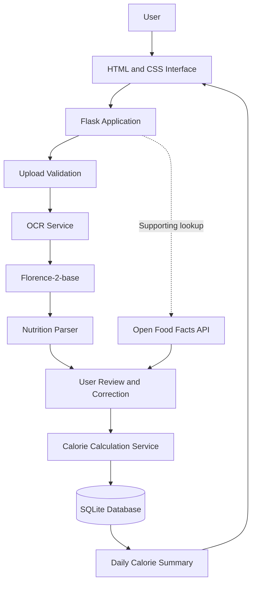
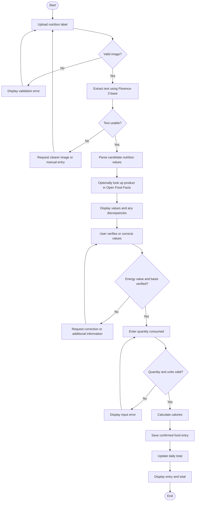

# CaloAI

**A Namibia-focused calorie-tracking proof of concept using image-to-text extraction and nutritional data.**

| Project detail | Description |
|---|---|
| Project status | Prototype development and model evaluation |
| Development approach | Iterative Software Development Life Cycle (SDLC) |
| Target platform | Local web application |
| Primary language | Python |
| Frontend | HTML and CSS |
| Backend | Flask |
| Image-to-text model | Florence-2-base |
| Supporting nutritional data | Open Food Facts |
| Database | SQLite |

## 1. Project Overview

CaloAI is a calorie-tracking proof of concept designed to help users record calories consumed from packaged foods.

The application will accept an image of a product's nutrition label, extract text using the Florence-2-base model from Hugging Face, identify relevant nutritional information, and allow the user to verify the extracted values before calculating calories consumed.

Confirmed food entries will be stored locally, allowing the application to maintain a food log and calculate daily calorie totals.

Open Food Facts will provide supporting product and nutritional information. This will help identify products and cross-check extracted information when a matching record is available.

The project will prioritize products available in Namibia, including products that may be missing from online nutritional databases.

The initial implementation will run locally to minimize hosting costs and infrastructure requirements.

## 2. Problem Statement

Recording daily calorie intake from packaged foods requires users to read nutrition labels, identify the correct energy values and serving sizes, calculate the quantity consumed, and maintain a record of their intake.

This process can be time-consuming and susceptible to transcription and calculation errors. In addition, nutritional information for some products available in Namibia may not be available in online food databases.

CaloAI aims to simplify this process by combining image-to-text extraction, supporting nutritional data from Open Food Facts, deterministic calorie calculations, and daily food logging in one application.

## 3. Project Objectives

1. Develop a web interface for uploading nutrition-label images.
2. Integrate Florence-2-base for image-to-text extraction.
3. Extract candidate nutritional energy values, units and serving information from the resulting text.
4. Allow users to review and correct extracted nutritional values before calculation.
5. Calculate calories consumed from verified nutritional information and the quantity consumed.
6. Maintain a daily food log and display the total calories recorded for a selected date.
7. Integrate Open Food Facts as a supporting source of product and nutritional information.
8. Evaluate extraction performance using manually verified nutrition labels, including Namibian products.
9. Document the system architecture, model selection, risks, limitations and evaluation results.

## 4. Scope

### 4.1 Minimum Viable Product (MVP)

The initial release will include:

- A web interface for uploading nutrition-label images.
- Image validation and basic preprocessing.
- Image-to-text extraction using Florence-2-base.
- Display of the raw extracted text.
- Identification of candidate calorie values, units and serving bases.
- User review and correction of nutritional values.
- Input for the quantity of food consumed.
- Calorie calculations using verified values.
- Local storage of confirmed food entries using SQLite.
- A daily food log and calorie total.
- Input validation and error handling.
- Automated tests and setup documentation.

### 4.2 Supporting functionality

Open Food Facts will be integrated to:

- Retrieve product information when a product can be identified or searched for.
- Provide nutritional values when available.
- Cross-check product information against values extracted from the nutrition label.
- Indicate when product information is unavailable or differs from the label.

A small local test dataset may be maintained for Namibian products that are not represented in Open Food Facts.

### 4.3 Out of scope

The initial release will not include:

- Personalized meal plans or dietary recommendations.
- Medical or nutritional diagnosis.
- Automatic calorie estimation from photographs of entire meals.
- User accounts or cloud synchronization.
- A native mobile application.
- Custom model training or fine-tuning.
- Production-scale model-serving infrastructure.
- Barcode scanning as a mandatory input method.
- Automatic acceptance of unverified nutritional values.

These features may be considered in future iterations if time and project requirements permit.

## 5. Stakeholders and Users

**Primary user:** An individual who wants to track calorie intake from packaged foods.

**Project developer:** Responsible for requirements analysis, implementation, testing, documentation and evaluation.

**Academic supervisor:** Provides feedback on scope, technical decisions, feasibility and project deliverables.

## 6. Functional Requirements

| ID | Requirement | Priority |
|---|---|---|
| FR-01 | The system shall accept an image of a nutrition label in a supported image format. | Must |
| FR-02 | The system shall validate uploaded files before processing. | Must |
| FR-03 | The system shall extract text from an image using Florence-2-base. | Must |
| FR-04 | The system shall display the raw extracted text for inspection. | Must |
| FR-05 | The system shall identify candidate energy values, units and serving bases. | Must |
| FR-06 | The system shall allow users to review and correct extracted values. | Must |
| FR-07 | The system shall accept the quantity consumed in a supported unit. | Must |
| FR-08 | The system shall calculate calories using verified nutritional values and quantities. | Must |
| FR-09 | The system shall save confirmed food entries against a date. | Must |
| FR-10 | The system shall calculate and display the daily calorie total. | Must |
| FR-11 | The system shall handle unreadable images, missing values and invalid inputs without silently recording unverified results. | Must |
| FR-12 | The system should retrieve product information from Open Food Facts when a product can be identified or searched for. | Supporting |
| FR-13 | The system should compare available product information with extracted nutritional values. | Supporting |
| FR-14 | The system should allow manual product entry when a product cannot be found. | Supporting |
| FR-15 | The system should indicate when a database value conflicts with the user's nutrition label. | Supporting |

## 7. Non-Functional Requirements

| ID | Requirement | Verification |
|---|---|---|
| NFR-01 | Cost | Core functionality should run locally without paid inference or hosting services. |
| NFR-02 | Accuracy | Critical nutritional values shall be evaluated against manually verified label values. |
| NFR-03 | Reliability | Incomplete or unconfirmed nutritional data must not silently enter the daily total. |
| NFR-04 | Maintainability | OCR, parsing, product lookup, calculations and storage shall be separated into components. |
| NFR-05 | Usability | The interface shall clearly display extracted information, corrections, errors and daily totals. |
| NFR-06 | Performance | Inference time and resource usage shall be measured on the target laptop. |
| NFR-07 | Reproducibility | Dependencies and setup instructions shall be documented. |
| NFR-08 | Security | Uploads shall be validated, file sizes limited and temporary files handled safely. |
| NFR-09 | Testability | Parsing, calculations, storage and integration behaviour shall be independently testable. |
| NFR-10 | Extensibility | The OCR model shall be replaceable without redesigning the calorie calculation logic. |

## 8. Proposed Technology Stack

| Component | Technology | Purpose |
|---|---|---|
| Frontend | HTML | Image upload, nutrition form and food log |
| Styling | CSS | Interface layout and presentation |
| Backend | Python and Flask | Request handling and application coordination |
| Image-to-text | Hugging Face Transformers | Model loading and inference |
| Initial model | Florence-2-base | Extraction of text from nutrition-label images |
| Supporting data | Open Food Facts API | Product identification and nutritional cross-checking |
| Database | SQLite | Local food-entry storage |
| Image processing | Pillow | Image loading and preprocessing |
| Testing | pytest | Unit and integration testing |
| Version control | Git and GitHub | Source control and documentation |

The initial implementation will target local CPU inference. GPU acceleration may be investigated if it is compatible with the available hardware and software environment.

## 9. Software Architecture

CaloAI will use a modular architecture that separates the user interface, model inference, nutritional data processing, calculations and persistence.



### Component responsibilities

**Frontend**

- Accept nutrition-label images.
- Display raw OCR output and candidate nutritional values.
- Allow users to correct values and enter quantities.
- Display food entries, daily totals and error messages.

**Flask application**

- Receive requests and validate inputs.
- Coordinate image processing, OCR, parsing, product lookup and calculations.
- Return results to the interface.

**OCR service**

- Load and execute Florence-2-base.
- Accept an image and return extracted text.
- Keep model-specific implementation separate from the remaining application.

**Nutrition parser**

- Identify candidate numerical values and associated units.
- Determine whether values refer to 100 g, 100 ml or a serving.
- Flag missing or ambiguous information for review.

**Calorie calculation service**

- Validate quantities and compatible units.
- Convert energy units when necessary.
- Calculate calories using deterministic formulas.

**Database layer**

- Store confirmed food entries and the nutritional values used.
- Retrieve entries for a selected date.
- Support daily calorie aggregation.

**Open Food Facts service**

- Retrieve available product and nutritional information.
- Support product identification and nutritional cross-checking.
- Handle missing records, incomplete data and API failures independently of OCR.

## 10. Data Pipeline

The primary data pipeline will follow these steps:

1. **Image input:** The user uploads a nutrition-label image.
2. **Validation:** The backend checks the file type, size and image readability.
3. **Preprocessing:** The image is loaded and optionally resized or prepared for inference.
4. **OCR inference:** Florence-2-base extracts text from the image.
5. **Text inspection:** The raw extracted text is retained and displayed.
6. **Nutrition parsing:** The parser identifies candidate energy values, units and serving bases.
7. **Product lookup:** Open Food Facts is queried when product identification or search information is available.
8. **Cross-checking:** Available database information is compared with the extracted information, with discrepancies flagged.
9. **User verification:** The user confirms or corrects the nutritional values.
10. **Quantity input:** The user enters the amount consumed.
11. **Calculation:** The application calculates calories from the verified values and quantity.
12. **Persistence:** The confirmed entry is saved in SQLite.
13. **Daily aggregation:** The application sums confirmed entries for the selected date.
14. **Presentation:** The interface displays the food entry and updated daily total.

Open Food Facts is a supporting branch of the pipeline, not a mandatory dependency. If a product is missing or the API is unavailable, the user should still be able to enter verified nutritional information manually.

## 11. Activity Diagram



## 12. Calorie Calculation Rules

Calculations must use verified nutritional values, compatible units and the correct serving basis.

### 12.1 Energy stated per 100 g

If a label specifies energy in kcal per 100 g:

\[
\text{kcal consumed} =
\frac{\text{kcal per 100 g} \times \text{grams consumed}}{100}
\]

Example:

- Label value: 380 kcal per 100 g.
- Quantity consumed: 45 g.
- Calculation: \(380 \times 45 / 100\).
- Result: 171 kcal.

### 12.2 Energy stated per serving

If a label specifies 90 kcal per 30 g serving and the user consumes 60 g:

\[
\text{kcal consumed} =
90 \times \frac{60}{30} = 180
\]

The serving quantity and consumed quantity must use compatible units.

### 12.3 Kilojoule conversion

When the source provides energy in kilojoules:

\[
\text{kcal} = \frac{\text{kJ}}{4.184}
\]

The conversion must be applied to the appropriate energy value and serving basis.

### 12.4 Calculation safeguards

- Do not assume every energy value is stated per 100 g.
- Do not treat grams and millilitres as interchangeable without a justified conversion.
- Do not infer missing serving sizes.
- Validate positive quantities and supported units.
- Keep unconfirmed values out of the daily total.
- Store the values and units used in each calculation so that results can be reviewed.
- Treat OCR output as a candidate result, not verified nutritional information.

## 13. Proposed Data Model

The initial database will use a food-entry table.

| Field | Purpose |
|---|---|
| entry_id | Unique identifier for the entry |
| product_name | User-confirmed product name |
| date_consumed | Date associated with the entry |
| raw_ocr_text | Extracted text retained for troubleshooting and evaluation |
| energy_value | Confirmed numerical energy value |
| energy_unit | kcal or kJ |
| nutrition_basis | Per 100 g, per 100 ml or per serving |
| basis_quantity | Quantity associated with the energy value |
| consumed_quantity | Amount consumed |
| consumed_unit | g, ml or a supported serving unit |
| calculated_kcal | Calculated calories consumed |
| source | OCR, manual entry or Open Food Facts |
| created_at | Entry creation timestamp |

Additional fields may be introduced for an Open Food Facts product identifier, database-derived values, discrepancy status or model version if required by the implementation.

Daily totals will initially be calculated by summing confirmed food entries for the selected date.

## 14. Model Selection and Justification

### 14.1 Selected initial model: Florence-2-base

CaloAI will use **Florence-2-base** as its initial image-to-text model.

Model card: https://huggingface.co/microsoft/Florence-2-base

Florence-2 is a vision-language model that supports multiple image-related tasks, including OCR. It is being evaluated for its ability to extract text from complete nutrition-label images.

The choice is based on the following considerations:

- It supports image-to-text extraction.
- It can be integrated locally through Hugging Face Transformers.
- It avoids requiring a paid inference endpoint for the initial prototype.
- It provides a practical starting point for evaluating nutrition-label extraction.
- Its model-specific implementation can be isolated so that another model can be evaluated later.

These considerations justify evaluating Florence-2-base; they do not establish that it is the most accurate model for nutrition labels.

### 14.2 Initial observations

During the first local test, Florence-2-base loaded and processed the test images. However, some extracted text was incorrect or unusable, including inaccurate text and numerical output.

This demonstrates that successful model execution does not guarantee accurate nutritional extraction.

The initial results will be retained as baseline evaluation evidence. Image quality, preprocessing, task configuration and model suitability must be investigated before conclusions are drawn about overall performance.

### 14.3 Model evaluation criteria

Evaluation will use the same manually verified images and reference text wherever possible.

| Metric | Purpose |
|---|---|
| Character Error Rate (CER) | Measures transcription errors at character level |
| Exact energy-value accuracy | Measures whether the extracted numerical energy value is correct |
| Energy-unit accuracy | Measures correct identification of kcal or kJ |
| Serving-basis accuracy | Measures correct identification of per 100 g, per 100 ml or per serving |
| Critical-field accuracy | Measures whether required nutritional fields are correctly extracted together |
| Failure rate | Measures images producing missing, unusable or ambiguous results |
| Inference time | Measures processing time per image |
| Resource usage | Measures approximate memory use and hardware requirements |

The evaluation dataset should include clear labels, small text, angled images, different packaging styles and Namibian products.

Performance targets will be finalized before formal evaluation. Any reported accuracy must include the test-set size, the evaluation method and relevant limitations. Results from a small sample must not be presented as proof of general performance.

## 15. Open Food Facts Integration

Open Food Facts will serve as a supporting product and nutritional data source.

Website: https://world.openfoodfacts.org/

API documentation: https://openfoodfacts.github.io/documentation/

### 15.1 Intended use

The integration may be used to:

- Retrieve product names and available nutritional information.
- Help identify products.
- Compare database nutrition values with values extracted from a label.
- Support manual review when OCR results are uncertain.
- Identify products for which no database record is available.

### 15.2 Lookup workflow

1. Obtain a product identifier or search input from the user or application.
2. Query the relevant Open Food Facts endpoint.
3. Check whether a matching product record exists.
4. Inspect the availability and completeness of its nutritional information.
5. Compare relevant values with the extracted label values.
6. Display any missing information or discrepancies.
7. Allow the user to verify which values should be used.

The first implementation may use product search or a known product identifier. Barcode scanning is not required for the MVP.

### 15.3 Data quality and availability

Open Food Facts records may be missing, incomplete or inconsistent with the product currently in the user's possession.

Therefore:

- A missing product must not prevent manual entry.
- Database values must not automatically override the physical product label.
- Differences between sources must be visible to the user.
- The source of the confirmed value should be recorded.
- API failures must be handled without disabling image-based extraction.
- Applicable API usage requirements, attribution conditions and data licences must be reviewed.

Open Food Facts supports the workflow but does not replace verification of the nutrition label.

## 16. Model Replacement and Scalability

The application will depend on an OCR service interface rather than embedding Florence-2-specific logic throughout the codebase.

For example:

```python
class OCRService:
    def extract_text(self, image_path: str) -> str:
        raise NotImplementedError
```

A concrete implementation will load Florence-2-base and return its extracted text.

This separation allows the model implementation to change without requiring a redesign of the frontend, nutrition parser, calorie calculations or database.

### Model replacement procedure

1. Identify a candidate replacement model.
2. Review its intended task, licence and resource requirements.
3. Test it against the existing evaluation images.
4. Compare critical-field accuracy and failure rates.
5. Measure inference time and memory usage.
6. Run regression tests against the existing implementation.
7. Adopt the replacement only if results justify the change.
8. Document the model version, evaluation results and reason for the decision.

### Future scalability

If the project grows, OCR inference could be isolated behind a dedicated service. This would allow model execution to scale independently from the web application.

For the initial local prototype, a separate inference service is unnecessary. A modular local implementation is sufficient.

## 17. Risk Register

| Risk | Potential impact | Mitigation |
|---|---|---|
| OCR misreads numerical values | Incorrect calorie totals | Display raw output, require user verification and validate critical fields |
| Serving basis is ambiguous | Incorrect quantity calculations | Require a verified basis before calculation |
| Image quality is poor | Missing or inaccurate text | Validate images and request clearer photos where necessary |
| Open Food Facts record is missing | Product lookup cannot provide supporting data | Allow manual entry and continue the primary workflow |
| Open Food Facts data is outdated or incomplete | Incorrect cross-checking | Compare against the physical label and flag discrepancies |
| API is unavailable | Product lookup fails | Keep the core workflow independent of the API |
| Model is too resource-intensive | Slow inference or memory exhaustion | Measure resource usage and evaluate alternatives if necessary |
| Model performs poorly on nutrition labels | Unusable nutritional extraction | Maintain a fixed evaluation dataset and investigate preprocessing or alternatives |
| Replacement model reduces accuracy | Regression in extraction quality | Run the same evaluation and regression tests before replacement |
| Invalid or malicious uploads | Application instability or unsafe file handling | Validate files, restrict size and handle temporary files safely |
| Dependency incompatibility | Setup failures | Use a virtual environment and document tested versions |

The main reliability concern is that OCR errors can become calculation errors. User verification and deterministic calculations reduce this risk, although they do not eliminate the possibility of incorrect user-confirmed values.

## 18. Acceptance Criteria

The MVP will be considered ready for demonstration when:

- A valid nutrition-label image can be uploaded.
- Florence-2-base produces inspectable text output.
- The application identifies candidate energy values and their serving basis.
- Users can correct extracted values before calculation.
- Valid quantities produce the expected calorie calculations.
- Confirmed food entries can be saved and retrieved.
- The daily total matches the sum of confirmed entries for the selected date.
- Invalid quantities and ambiguous nutritional data are handled safely.
- Open Food Facts can provide supporting data when a suitable record is available.
- Missing database records do not prevent manual label processing.
- API failures do not disable the primary workflow.
- Automated tests cover calculations, parsing and critical failure cases.
- Setup instructions allow the project to be reproduced in the documented environment.
- Model evaluation results and known limitations are documented.

Model accuracy targets will be defined and evaluated separately. A functioning demonstration alone does not establish that OCR results are sufficiently accurate for unrestricted use.

## 19. Testing Strategy

### 19.1 Unit testing

Test the following independently:

- Energy unit conversion.
- Calories-per-100-g calculations.
- Calories-per-serving calculations.
- Nutrition parsing.
- Quantity validation.
- Serving-basis validation.
- Daily-total aggregation.

### 19.2 Integration testing

Test interactions between:

- Image preprocessing and model inference.
- OCR output and nutrition parsing.
- Parsed values and user correction.
- Verified values and calorie calculations.
- Calculations and SQLite storage.
- Open Food Facts responses and discrepancy handling.

### 19.3 API testing

Test:

- Successful product lookups.
- Products that are not found.
- Incomplete nutritional records.
- Conflicting database and label values.
- Network errors and API unavailability.

### 19.4 End-to-end testing

Complete the entire workflow from uploading a label to displaying the updated daily calorie total.

### 19.5 Model evaluation

Create a ground-truth dataset by manually transcribing the nutrition labels. Verify the reference text and critical numerical values against the original images.

Run Florence-2-base against the same images, compare its output with the reference, and record errors.

The evaluation report must state the number of images tested, the metrics used, observed results and known limitations. Do not claim an accuracy percentage before performing the evaluation.

## 20. Development Plan

The project will follow an iterative SDLC approach. The order of work may change according to test results and supervisor feedback.

| Phase | Activities | Deliverable |
|---|---|---|
| 1. Requirements | Define objectives, scope, requirements and acceptance criteria | Requirements baseline |
| 2. Design | Define architecture, data pipeline, diagrams and data model | Design documentation |
| 3. Model evaluation | Test Florence-2-base and establish baseline results | Initial evaluation report |
| 4. Interface | Build the Flask application and image-upload page | Working upload interface |
| 5. OCR integration | Connect model inference to the application | Image-to-text workflow |
| 6. Data processing | Parse candidate nutritional values and validate serving bases | Nutrition-processing component |
| 7. Calorie calculations | Implement and test calculation rules | Calculation component |
| 8. Storage | Save entries and retrieve daily totals | SQLite food log |
| 9. Product integration | Connect Open Food Facts and handle missing records | Supporting product lookup |
| 10. Testing | Complete unit, integration and end-to-end tests | Test results |
| 11. Evaluation | Evaluate extraction, errors and performance | Evaluation report |
| 12. Documentation | Finalize setup, limitations and technical decisions | Updated README |
| 13. Demonstration | Verify the end-to-end workflow in the target environment | Demonstrable MVP |

Core workflow completion takes priority over optional features.

## 21. Development Principles

- Keep the initial implementation small and testable.
- Prefer local execution and free resources.
- Use Florence-2-base as the initial model under evaluation.
- Separate model inference from application logic.
- Treat model output as unverified until reviewed.
- Use deterministic code for nutritional calculations.
- Keep Open Food Facts supporting rather than mandatory.
- Test with real product labels, including Namibian products.
- Record actual results instead of making unsupported accuracy claims.
- Document model versions, dependencies and significant design changes.
- Keep optional features out of the MVP unless the core workflow is complete.

## 22. References

- Florence-2-base model card: https://huggingface.co/microsoft/Florence-2-base
- Hugging Face model hub: https://huggingface.co/models
- Open Food Facts: https://world.openfoodfacts.org/
- Open Food Facts API documentation: https://openfoodfacts.github.io/documentation/
- Flask documentation: https://flask.palletsprojects.com/
- Python documentation: https://docs.python.org/3/
- SQLite documentation: https://www.sqlite.org/docs.html
- pytest documentation: https://docs.pytest.org/

The licences and terms applicable to the selected model, datasets, product records and images must be reviewed before reuse.

## 23. Current Project Status

| Area | Status |
|---|---|
| Project objectives and scope | Drafted |
| Functional and non-functional requirements | Drafted |
| Architecture and diagrams | Proposed |
| Data model and calculation rules | Proposed |
| Florence-2-base environment setup | Completed sufficiently to run an initial test |
| Initial Florence-2-base inference | Tested |
| Initial extraction quality | Poor on the first test images; further evaluation required |
| Nutrition-label ground truth | To be verified and expanded |
| Flask interface | Pending |
| Nutrition parsing and validation | Pending |
| Calorie calculation service | Pending |
| SQLite food log | Pending |
| Open Food Facts integration | Pending |
| Automated tests | Pending |
| Formal model evaluation | Pending |
| Supervisor review | Requires confirmation |

This README is a living project specification. Update it as implementation decisions are finalized, testing produces evidence and supervisor feedback is received.
